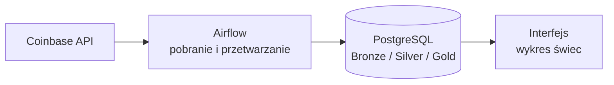
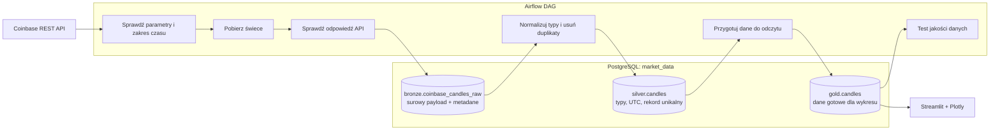

# Architektura projektu danych kryptowalutowych

## Założenia pierwszej wersji

- Źródło: publiczne API Coinbase.
- Orkiestracja: Apache Airflow.
- Magazyn: PostgreSQL.
- Uruchamianie lokalne: Docker Compose.
- Prezentacja świec: Streamlit + Plotly (propozycja upraszczająca naukę).
- Pierwszy zakres: jedna para, np. `BTC-USD`, i jedna granulacja.

## 1. Widok bardzo ogólny



Airflow uruchamia pracę w określonych odstępach. Dane przechodzą przez trzy
warstwy w PostgreSQL. Interfejs tylko czyta gotowe dane z warstwy Gold.

## 2. Widok bardziej szczegółowy



### Odpowiedzialność warstw

| Warstwa | Cel | Przykładowa zawartość |
|---|---|---|
| Bronze | Zachować to, co zwróciło źródło | payload JSON, czas pobrania, produkt, zakres zapytania, status odpowiedzi |
| Silver | Nadać stały i poprawny model | czas UTC, OHLCV jako liczby, deduplikacja, walidacja |
| Gold | Ułatwić odczyt aplikacji | świece posortowane i gotowe do filtrowania według produktu, czasu i granulacji |

W pierwszej wersji Gold może wyglądać podobnie do Silver. To jest w porządku:
różnica polega na odpowiedzialności. Silver jest modelem poprawnych danych,
a Gold jest stabilnym kontraktem dla interfejsu.

## Przepływ jednego uruchomienia DAG-a

1. Airflow wyznacza zamknięty przedział czasu do pobrania.
2. Zadanie pobierające wywołuje Coinbase z limitem czasu i kilkoma ponowieniami.
3. Nieprzetworzona odpowiedź oraz metadane trafiają do Bronze.
4. Transformacja odczytuje Bronze i zapisuje poprawne, unikalne rekordy do Silver.
5. Transformacja Gold przygotowuje kontrakt odczytowy dla wykresu.
6. Test jakości sprawdza m.in. unikalność, kolejność OHLC i brak luk.
7. Interfejs pobiera wyłącznie dane Gold; nie wywołuje Coinbase.

## Proponowany model danych

Najważniejszy klucz świecy to:

`(source, product_id, granularity_seconds, candle_start)`

Ten klucz powinien być unikalny w Silver i Gold. Dzięki temu ponowne uruchomienie
tego samego przedziału nie tworzy duplikatów. Zapis powinien działać jako upsert.

Warto przechowywać wszystkie czasy w UTC. Strefę lokalną należy stosować dopiero
przy wyświetlaniu.

## Docelowa struktura katalogów

To jest plan struktury, a nie kod do utworzenia od razu.

```text
MarketDataHandcoded/
├── dags/                       # cienkie definicje DAG-ów i zależności zadań
├── src/
│   └── market_data/
│       ├── coinbase/           # klient API i mapowanie odpowiedzi
│       ├── bronze/             # zapis surowych danych
│       ├── silver/             # normalizacja i deduplikacja
│       ├── gold/               # model dla odbiorców danych
│       ├── database/           # połączenia i operacje bazodanowe
│       └── quality/            # reguły jakości danych
├── sql/
│   ├── migrations/             # tworzenie i zmiany schematów/tabel
│   └── checks/                 # jawne zapytania jakościowe
├── dashboard/                  # interfejs świec; czyta tylko Gold
├── tests/
│   ├── unit/                   # logika bez sieci i bazy
│   └── integration/            # Postgres i przykładowe odpowiedzi API
├── docker/                     # pliki konfiguracyjne obrazów, jeśli potrzebne
├── docs/                       # decyzje i instrukcje uruchomienia
├── TODO/                       # roadmapa i bilety deweloperskie
├── docker-compose.yml
├── .env.example                # nazwy zmiennych, bez sekretów
└── README.md
```

## Jak rozdzielać kod

- DAG ma opisywać kolejność i harmonogram, a nie zawierać całą logikę biznesową.
- Funkcje transformujące powinny dać się uruchomić i testować bez Airflow.
- Klient Coinbase odpowiada za HTTP, limity czasu, błędy i format źródłowy.
- Warstwa bazy odpowiada za transakcje, zapytania i upsert.
- Dashboard nie powinien znać tabel Bronze ani Silver.
- SQL zmieniający strukturę bazy powinien być wersjonowany jako migracje.

## Ważne podczas rozwoju

- **Idempotencja:** ponowne uruchomienie DAG-a daje ten sam wynik.
- **Przedziały czasu:** używaj granic przekazanych przez Airflow, nie `now()` w logice zadań.
- **UTC:** baza i pipeline pracują w UTC.
- **Rate limit:** ogranicz liczbę zapytań, pobieraj dane partiami i stosuj retry z opóźnieniem.
- **Obserwowalność:** loguj produkt, zakres czasu, liczbę pobranych i zapisanych rekordów.
- **Sekrety:** nie zapisuj haseł w repozytorium; użyj zmiennych środowiskowych lub Connections Airflow.
- **Małe zadania:** osobne kroki pobrania, Silver, Gold i kontroli jakości łatwiej ponawiać i diagnozować.
- **Backfill:** najpierw sprawdź pojedynczy przedział, potem dopiero pobieraj historię.
- **Kontrakt API:** zachowaj przykładowe odpowiedzi jako fixture testowe, bo format źródła może się zmienić.

## Świadomie odłożone na później

- Kafka lub inny streaming.
- Kubernetes i chmura.
- Wiele giełd.
- Dane sekundowe i aktualizacja w czasie rzeczywistym.
- Rozbudowane narzędzie transformacji, np. dbt. Warto je rozważyć dopiero, gdy
  liczba modeli SQL zacznie utrudniać testowanie i śledzenie zależności.

