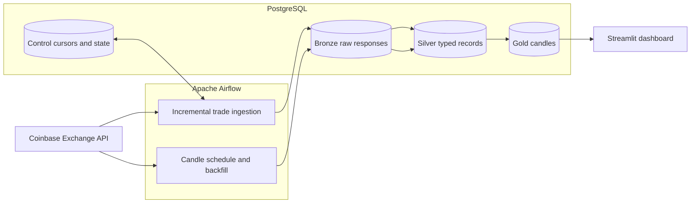

# Coinbase Market Data Pipeline

An end-to-end data engineering project that ingests public Coinbase market
data, preserves raw API responses, builds typed PostgreSQL models, and serves
daily candlestick data through a read-only Streamlit dashboard.

The repository focuses on reliability patterns that matter in batch data
platforms: idempotent writes, bounded backfills, cursor-based incremental
ingestion, durable watermarks, explicit data contracts, schema migrations, and
least-privilege database access.

## Architecture



### Implemented pipelines

| Pipeline | Schedule | Data path | Reliability behavior |
|---|---|---|---|
| Candles | Hourly | Bronze → Silver → Gold | Closed Airflow intervals, API retries, typed validation, idempotent upserts |
| Candle backfill | Manual | Bronze → Silver → Gold | Validated bounded range, requests split at the 300-candle API limit, dynamic task mapping |
| Trades | Every 15 minutes or manual catch-up | Bronze → Silver + Control | Cursor pagination, bounded pages per run, watermark advances only after Silver commits |

Trade aggregates and retention are deliberately still roadmap items. The
dashboard currently exposes daily candles only.

## Technology

- Apache Airflow 3.3.0 with LocalExecutor
- PostgreSQL 13
- Flyway 13
- Python 3.13
- Streamlit and Plotly
- Docker Compose

## Quickstart

### Prerequisites

- Docker Desktop with Docker Compose
- PowerShell 7 or Windows PowerShell 5.1 for the helper scripts
- Free local ports `8080`, `8501`, and `5050`

### 1. Configure local credentials

```powershell
Copy-Item .env.example .env
```

Replace every `change-me` value in `.env`. Keep this file local; Git ignores
it. Use URL-safe characters for `AIRFLOW_MARKET_DATA_PASSWORD` because it is
embedded in an Airflow connection URI.

### 2. Apply migrations and start the stack

```powershell
./scripts/start.ps1
```

The script validates the Compose configuration, provisions the application
roles, applies all Flyway migrations, builds the dashboard, and starts the
services.

### 3. Open the services

- Airflow: <http://localhost:8080>
- Dashboard: <http://localhost:8501>
- pgAdmin: <http://localhost:5050>

The initial Airflow and pgAdmin credentials come from `.env`.

### 4. Run the portfolio walkthrough

The following walkthrough demonstrates the complete path from Coinbase to
Airflow, PostgreSQL, and the dashboard. It uses one week of daily `BTC-USD`
candles, which stays within Coinbase's per-request limit and normally creates
one mapped ingest task.

In Airflow, open the `coinbase_backfill` DAG and trigger it with these
parameters:

```json
{
  "product_id": "BTC-USD",
  "granularity_seconds": 86400,
  "start": "2025-01-01T00:00:00Z",
  "end": "2025-01-08T00:00:00Z"
}
```

Wait for `create_backfill_intervals`, the mapped
`ingest_backfill_interval`, `load_backfill_silver`, and
`load_backfill_gold` tasks to finish successfully. In a Silver task's log,
search for `market_data_stage_summary`. A complete interval should include
values similar to:

```text
stage=silver records_accepted=7 duplicate_records=0
expected_buckets=7 actual_buckets=7 missing_buckets=0 coverage_status=complete
```

The exact fetched count can vary because Coinbase may return a candle outside
the requested range. A missing candle produces a
`coinbase_candle_coverage_partial` warning but does not fail the Silver task.

Refresh the dashboard and select `BTC-USD`. The chart should show the seven
daily candles loaded into Gold. This proves the visible path:

```text
Coinbase API -> Bronze -> Silver -> Gold -> Streamlit
```

For an operational demonstration, trigger `coinbase_candles_hourly` as well.
Open the `load_silver` task log and search for the same stage summary and
coverage warning messages. The `load_gold` log reports the number of rows
written to the dashboard-facing layer.

When finished, stop the containers without deleting their volumes:

```powershell
docker compose down
```

## Verification

Run the complete local verification suite with:

```powershell
./scripts/verify.ps1
```

It performs four checks:

1. validates the Docker Compose configuration;
2. compiles the Python source and tests inside the pinned Airflow image;
3. runs the unit tests inside the same image;
4. creates an isolated `market_data_integration_test` database, applies the
   complete SQL migration chain, proves candle reprocessing is idempotent, and
   verifies runtime and dashboard permissions.

The integration suite refuses to run against a database whose name does not
end in `_test`. It never drops or rebuilds the development `market_data`
database.

For lightweight static checks outside Docker:

```powershell
python -m pip install -r requirements-dev.txt
ruff check .
```

## Reliability decisions

### Idempotency

Bronze identifies individual request attempts with `bronze_request_key`.
Silver and Gold use natural market-data keys and PostgreSQL upserts, so task
retries and repeated backfills do not create duplicate business records.

### Trade cursor safety

`control.trade_ingestions` stores separate live and catch-up process state. A
trade page is written to Bronze first. Its cursor moves only in the same
transaction that commits validated Silver records, allowing a failed run to
resume without skipping trades.

### Error handling

Timeouts, HTTP 429 responses, and server errors are eligible for bounded
Airflow retries with exponential backoff. Invalid requests, non-retryable HTTP
responses, and deterministic payload-contract failures stop immediately.

### Security boundary

Flyway owns database objects. Airflow receives only the DML required by the
pipelines. The dashboard role is read-only and can access Gold but not Bronze,
Silver, or Control data.

## Repository map

```text
dags/                 Airflow DAGs and testable pipeline modules
dashboard/            Streamlit application and read-only SQL
sql/migrations/       Ordered Flyway migrations
postgres/             Database and role provisioning
tests/unit/           Network-free unit tests
tests/integration/    Isolated PostgreSQL migration and pipeline tests
docs/                 Operational and data-contract documentation
TODO/                 Explicit roadmap and completion criteria
scripts/              One-command startup and verification helpers
```

More detailed design notes are in [ARCHITECTURE.md](ARCHITECTURE.md). Operational
guides cover the [scheduled candle DAG](docs/airflow-dag.md),
[backfills](docs/backfill-dag.md), [trade ingestion](docs/trades-dag.md),
[database roles](docs/database-access.md), and the
[Gold contract](docs/gold-layer.md).

## Current limitations and roadmap

- Only `BTC-USD` is enabled.
- The dashboard exposes daily candles rather than the trade pipeline.
- Data validation is enforced during parsing and by PostgreSQL constraints,
  but quality results and freshness history are not yet persisted as a
  separate DAG stage.
- Trade aggregation, measured retention, and capacity reporting remain open in
  [TODO/TICKETS.md](TODO/TICKETS.md).
- The stack is intentionally local. Kafka, Kubernetes, cloud infrastructure,
  and multiple exchanges are outside the current scope.

These constraints are intentional: the current release prioritizes a small,
reproducible pipeline with explicit failure and replay behavior.
