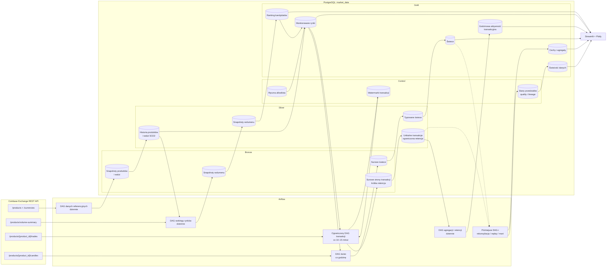

# Bilety implementacyjne

## TICKET-001 — Lokalne środowisko Docker

**Cel:** uruchomić Airflow i PostgreSQL bez budowania pipeline'u.

- [x] Zdefiniuj usługi PostgreSQL, Airflow API Server, scheduler i DAG Processor.
- [x] W jednym kontenerze PostgreSQL utwórz osobne bazy: metadane Airflow i `market_data`.
- [x] Dodaj healthchecki i trwałe wolumeny.
- [x] Dodaj `.env.example`, ale nie commituj prawdziwych haseł.
- [x] Zaloguj się do UI Airflow i uruchom pusty testowy DAG ręcznie.

**Gotowe, gdy:** po restarcie kontenerów UI działa, a dane PostgreSQL nie znikają.

## TICKET-002 — Schemat bazy i migracje

**Cel:** utworzyć schematy `bronze`, `silver` i `gold` w bazie `market_data`.

- [x] Opisz kolumny tabeli surowych odpowiedzi Bronze.
- [x] Opisz typowany model świecy Silver.
- [x] Opisz stabilny model odczytowy Gold.
- [x] Dodaj klucz unikalny dla produktu, granulacji i czasu świecy.
- [x] Zdecyduj, jak uruchamiane i wersjonowane będą migracje.

**Gotowe, gdy:** pustą bazę można odtworzyć w powtarzalny sposób.

## TICKET-003 — Rozpoznanie API Coinbase

**Cel:** zrozumieć kontrakt źródła przed pisaniem DAG-a.

- [x] Przeczytaj aktualną dokumentację endpointu świec.
- [x] Zanotuj limit rekordów, dozwolone granulacje i zachowanie granic czasu.
- [x] Zapisz małą przykładową odpowiedź jako fixture testowy.
- [x] Sprawdź odpowiedź dla błędnego produktu i pustego zakresu.

**Gotowe, gdy:** potrafisz ręcznie wyjaśnić każde pole odpowiedzi i ograniczenia endpointu.

## TICKET-004 — Ingest do Bronze

**Cel:** zachować surową odpowiedź i kontekst pobrania.

- [x] Pobierz tylko jeden mały, jawny przedział czasu.
- [x] Ustaw timeout oraz ograniczone retry.
- [x] Zapisz payload i metadane zapytania w jednej transakcji.
- [x] Loguj zakres, produkt oraz liczbę rekordów; nie loguj sekretów.
- [x] Zdefiniuj bezpieczne zachowanie przy ponownym uruchomieniu.

**Gotowe, gdy:** można powtórzyć pobranie i ustalić, z jakiego zapytania pochodzi payload.

## TICKET-005 — Transformacja Bronze → Silver

**Cel:** uzyskać poprawne, typowane i unikalne świece.

- [x] Zamień czas na UTC oraz ceny i wolumen na typ numeryczny.
- [x] Sprawdź wymagane pola i sensowne zależności OHLC.
- [x] Usuń duplikaty według klucza świecy.
- [x] Zapisuj przez upsert.
- [x] Dodaj test jednostkowy z fixture bez sieci i Airflow.

**Gotowe, gdy:** dwukrotne przetworzenie payloadu daje jeden zestaw rekordów.

## TICKET-006 — Warstwa Gold

**Cel:** dostarczyć prosty i stabilny kontrakt dla interfejsu.

- [x] Ustal minimalny zestaw pól potrzebny wykresowi świec.
- [x] Zapewnij szybkie filtrowanie po produkcie, granulacji i czasie.
- [x] Wybierz tabelę lub widok i zapisz uzasadnienie decyzji.
- [x] Dodaj test liczby rekordów oraz unikalności.

**Gotowe, gdy:** pojedyncze zapytanie zwraca posortowane dane do wykresu.

## TICKET-007 — DAG Airflow

**Cel:** połączyć istniejące, testowalne kroki w powtarzalny pipeline.

- [x] Zdefiniuj harmonogram, `start_date`, `catchup` i retry.
- [x] Użyj przedziału danych przekazanego przez Airflow.
- [x] Ułóż zależności: ingest → Silver → Gold.
- [ ] Dodaj osobny krok zapisujący wyniki jakości i świeżości.
- [x] Przekazuj między zadaniami małe metadane, a nie całe payloady.
- [x] Przetestuj ręczny run i ponowienie nieudanego zadania.

**Gotowe, gdy:** widok Grid pokazuje udany pełny przebieg dla jednego przedziału.

## TICKET-008 — Wykres świec

**Cel:** wyświetlić dane Gold bez łączenia interfejsu z pipeline'em.

- [x] Utwórz minimalny ekran Streamlit z wykresem Plotly.
- [x] Dodaj wybór produktu i zakresu czasu dopiero po działaniu wersji stałej.
- [x] Ogranicz liczbę pobieranych rekordów.
- [x] Obsłuż pusty wynik czytelnym komunikatem.
- [x] Użyj użytkownika bazy z prawem tylko do odczytu Gold.

**Gotowe, gdy:** wykres działa także wtedy, gdy Airflow jest chwilowo zatrzymany.

## TICKET-009 — Jakość i eksploatacja

**Cel:** wykrywać problemy, zanim trafią na wykres.

- [x] Sprawdzaj unikalność, wartości null i kolejność OHLC.
- [ ] Dodaj kontrolę luk i świeżości z zapisem wyniku.
- [x] Rozróżnij błędy chwilowe API od błędów danych.
- [x] Dodaj test integracyjny z PostgreSQL.
- [x] Loguj w Airflow liczbę rekordów pobranych, zaakceptowanych, zduplikowanych,
  odfiltrowanych i zapisanych; nie zapisuj tych liczników w bazie.
- [x] Opisz procedurę małego backfillu i ponowienia zadania.

**Gotowe, gdy:** celowo uszkodzony fixture powoduje czytelny błąd odpowiedniego zadania.

## Proponowana kolejność dalszego rozwoju

Przed rozpoczęciem nowych przypadków użycia warto dokończyć pozostałą część
TICKET-009. W szczególności kontrola luk i świeżości z trwałym wynikiem będzie
stanowić bazę dla kolejnych DAG-ów; liczniki etapów są już dostępne w logach
Airflow bez powiększania modelu danych.

Aktualne priorytety to TICKET-010, TICKET-011 i TICKET-012. Rekomendowana
kolejność implementacji to TICKET-010 → 011 → 012 → 013, a następnie dalsze
tickety 014–017. Każdy ticket daje działający rezultat i może zostać zatrzymany
bez konieczności wdrażania pozostałych.

## TICKET-010 — Ograniczony, inkrementalny ingest transakcji

**Priorytet:** aktualny.

**Przypadek użycia:** pipeline regularnie pobiera nowe transakcje dla małego,
jawnie ograniczonego zakresu i wznawia pracę od ostatniego bezpiecznego punktu.
Celem nie jest bezterminowe archiwum całego Coinbase trade tape, lecz nauka
przyrostowego ingestu na kontrolowanym oknie danych.

**Cel edukacyjny:** ekstrakcja przyrostowa, cursor pagination, watermarks,
deduplikacja, bezpieczne wznawianie DAG-a, capacity planning i retencja danych.

- [x] Dodaj migrację `bronze.coinbase_trades_raw` przechowującą niezmieniony payload strony, produkt, czas żądania, status HTTP oraz nagłówki `CB-BEFORE` i `CB-AFTER`.
- [x] Dodaj `silver.trades` z kluczem `(source, product_id, trade_id)`, czasem UTC, ceną i wielkością jako `NUMERIC` oraz stroną maker.
- [x] Dodaj migrację Flyway tworzącą schemat `control`, minimalne uprawnienia roli Airflow i zunifikowany stan `control.trade_ingestions` z kursorem, najwyższym `trade_id`, trybem oraz postępem procesu.
- [x] Zaimplementuj pobieranie strony niezależnie od Airflow oraz zapis Bronze, transformację Silver i aktualizację watermarku w kontrolowanej kolejności.
- [x] Aktualizuj watermark dopiero po zatwierdzeniu Silver; awaria pomiędzy Bronze i Silver ma prowadzić do bezpiecznego ponowienia, a nie utraty transakcji.
- [x] Pierwszą wersję uruchom wyłącznie dla `BTC-USD`; kolejne produkty dodawaj dopiero po pomiarze tygodniowego przyrostu danych.
- [x] Utwórz DAG uruchamiany początkowo co 10–15 minut z `max_active_runs=1` i osobnym Airflow Pool dla endpointu trades.
- [x] Wprowadź konfigurowalne `max_pages_per_run` oraz maksymalny czas zadania; zacznij od 2–5 stron, a pozostawiony backlog obsłuż w kolejnych runach.
- [x] Ponawiaj timeouty, HTTP 429 i 5xx z exponential backoff; nie ponawiaj deterministycznych błędów kontraktu danych.
- [x] Dodaj ograniczony tryb catch-up z jawnym najstarszym czasem lub kursorem; nie pozwalaj na nieograniczone pobranie całej historii.
- [ ] Dodaj `gold.trade_activity_hourly` z liczbą transakcji, base volume, quote volume, VWAP oraz licznikami maker buy/sell; agregaty przechowuj dłużej niż pojedyncze transakcje.
- [ ] Zdefiniuj konfigurowalną politykę retencji; jako wartości startowe przyjmij 7 dni dla Bronze i 30 dni dla Silver, ale zatwierdź je po pierwszym tygodniu pomiarów.
- [ ] Dodaj dzienny krok retencji usuwający dane małymi partiami dopiero po udanym zbudowaniu i sprawdzeniu agregatów; zachowaj watermarki i metryki wykonania.
- [ ] Jawnie zdecyduj, jak zachować lineage Silver po usunięciu krócej przechowywanego Bronze, np. przez trwałe metadane ingestu w `control` zamiast blokującego klucza obcego.
- [ ] Mierz liczbę pobranych stron, rekordów surowych, nowych transakcji, duplikatów, backlog, opóźnienie ostatniej transakcji oraz rozmiar tabel i indeksów.
- [ ] Po 7 dniach przygotuj raport pojemności: rekordy/dzień, MB/dzień, przewidywany rozmiar miesięczny oraz rekomendowany harmonogram i retencję.
- [ ] Dodaj testy pierwszego uruchomienia, pustej strony, nakładających się stron, restartu po zapisie Bronze oraz ponownego przetworzenia tego samego kursora.
- [ ] Dodaj test retencji potwierdzający, że świeże rekordy i watermark pozostają, stare rekordy są usuwane, a agregat Gold się nie zmienia.

**Gotowe, gdy:** przez co najmniej siedem dni `BTC-USD` działa bez utraty danych i
nieograniczonego catch-upu, ponowienie nie tworzy duplikatów, retencja zachowuje
agregaty, a zmierzony przyrost pozwala świadomie zdecydować o kolejnym produkcie.

## TICKET-011 — Historia statusów produktów i walut

**Priorytet:** aktualny.

**Przypadek użycia:** pipeline wie, kiedy produkt lub waluta były aktywne,
ograniczone albo wycofane, dzięki czemu potrafi zatrzymać ingest i poprawnie
wyjaśnić brak danych.

**Cel edukacyjny:** snapshoty danych referencyjnych, slowly changing dimension
typu 2, change detection i temporalne łączenie faktów z wymiarami.

- [ ] Opisz kontrakty `GET /products` i `GET /currencies`; zapisz fixture pełnego snapshotu oraz odpowiedzi błędnej lub podejrzanie małej.
- [ ] Dodaj `bronze.coinbase_products_raw` i `bronze.coinbase_currencies_raw` przechowujące pełne, niezmienione snapshoty wraz z metadanymi żądania.
- [ ] Zdefiniuj minimalny zestaw śledzonych atrybutów produktu: status, ograniczenia handlu, base/quote currency, precyzję i oznaczenie stable pair.
- [ ] Zdefiniuj minimalny zestaw śledzonych atrybutów waluty: status, precyzję, typ, sieć domyślną i obsługiwane sieci, jeśli występują w źródle.
- [ ] Dodaj `silver.products_history` i `silver.currencies_history` z `valid_from`, `valid_to`, `is_current`, hashem śledzonych atrybutów i odwołaniem do Bronze.
- [ ] Zamykaj poprzednią wersję i twórz nową tylko wtedy, gdy zmienił się śledzony atrybut; identyczny snapshot ma być idempotentny.
- [ ] Nie oznaczaj produktu jako wycofanego wyłącznie dlatego, że zniknął z jednego snapshotu; najpierw sprawdź kompletność odpowiedzi lub wymagaj kolejnych obserwacji.
- [ ] Dodaj dzienny DAG `coinbase_reference_data` z osobnymi zadaniami fetch → Bronze → Silver → quality dla produktów i walut.
- [ ] Dodaj `gold.current_products` oraz `gold.current_currencies` jako bieżący kontrakt dla pozostałych DAG-ów i dashboardu.
- [ ] Dodaj testy braku nakładających się okresów ważności, dokładnie jednej bieżącej wersji i temporalnego odczytu statusu dla wskazanego czasu.

**Gotowe, gdy:** zmiana `online` → `offline` → `online` tworzy trzy poprawne
okresy historii, a DAG ingestu może ustalić status produktu dla danego czasu.

## TICKET-012 — Dynamiczny wybór rynków na podstawie płynności

**Priorytet:** aktualny.

**Przypadek użycia:** aplikacja regularnie tworzy ranking płynnych i dostępnych
par Coinbase oraz proponuje rynki, które warto objąć ingestem.

**Cel edukacyjny:** snapshot faktów, reguły kwalifikacji, ranking, data-driven
DAG generation oraz kontrolowane połączenie automatyzacji z ręczną akceptacją.

- [ ] Opisz kontrakt `GET /products/volume-summary`, jednostki wolumenu i różnicę pomiędzy spot, RFQ oraz conversion volume.
- [ ] Dodaj `bronze.coinbase_product_volume_raw` przechowującą pełny snapshot odpowiedzi, czas pobrania i metadane HTTP.
- [ ] Dodaj `silver.product_volume_snapshots` z produktem, czasem snapshotu, wolumenem 24h i 30d oraz typem rynku.
- [ ] Zdefiniuj jawne reguły kwalifikacji, np. quote currency, typ spot, bieżący status produktu, brak ograniczeń handlu i minimalny wolumen.
- [ ] Dodaj `control.market_allowlist` oddzielającą rekomendację pipeline'u od decyzji o faktycznym uruchomieniu ingestu.
- [ ] Dodaj `gold.market_candidates` z rankingiem, powodami kwalifikacji lub odrzucenia i zmianą pozycji względem poprzedniego snapshotu.
- [ ] Utwórz dzienny DAG zależny od udanego odświeżenia danych referencyjnych: volume snapshot → normalizacja → ranking → quality → publish.
- [ ] Nie aktywuj automatycznie nowych produktów; pokaż je jako kandydatów wymagających wpisu do allowlisty.
- [ ] Zbuduj listę produktów dla DAG-ów świec i transakcji jako przecięcie: allowlista ∩ bieżący status online ∩ brak ograniczeń handlu.
- [ ] Użyj dynamic task mapping i Airflow Pool, aby dodanie zatwierdzonego rynku nie wymagało kopiowania definicji DAG-a.
- [ ] Dodaj testy remisu w rankingu, brakującego wolumenu, stable pair, zmiany statusu i usunięcia produktu z allowlisty.
- [ ] Dodaj w dashboardzie widok kandydatów i uzasadnienie rankingu, ale bez możliwości modyfikowania allowlisty przez użytkownika read-only.

**Gotowe, gdy:** dzienny run tworzy powtarzalny ranking, nowy produkt pojawia się
jako kandydat, a ingest obejmuje go dopiero po świadomym dodaniu do allowlisty.

## TICKET-013 — Wiele produktów i granulacji w jednym harmonogramie

**Przypadek użycia:** ten sam pipeline aktualizuje świece i transakcje np. dla
`BTC-USD`, `ETH-USD` i `SOL-USD`, a dashboard pozwala je porównywać.

**Cel edukacyjny:** dynamic task mapping, TaskGroup, Airflow Pools, limity
współbieżności i parametryzacja DAG-a bez kopiowania kodu.

- [ ] Zmień stałe produktu i granulacji na walidowane wejście jednej jednostki pracy.
- [ ] Odczytuj aktywne produkty z kontraktu utworzonego w TICKET-012.
- [ ] Zbuduj listę jednostek pracy dla data interval i mapuj po niej zadania ingest → Silver → Gold → quality.
- [ ] Zgrupuj zadania logicznie według rynku lub etapu, tak aby Grid view pozostał czytelny.
- [ ] Ustaw osobne limity współbieżności dla endpointów świec i transakcji.
- [ ] Przekazuj przez XCom wyłącznie identyfikatory, klucz rynku i liczniki rekordów.
- [ ] Upewnij się, że klucze idempotencji zawierają produkt, granulację, data interval i map index.
- [ ] Dodaj test pokazujący, że błąd jednego rynku jest widoczny osobno i nie miesza danych pozostałych rynków.

**Gotowe, gdy:** jeden zaplanowany run ładuje co najmniej trzy zatwierdzone rynki
bez przekroczenia limitu API i bez duplikowania definicji DAG-a.

## TICKET-014 — Crypto-aware rekonsyliacja luk i kontrolowany auto-repair

**Przypadek użycia:** aplikacja rozróżnia brak transakcji od awarii pipeline'u i
naprawia wyłącznie rzeczywiste braki danych.

**Cel edukacyjny:** rekonsyliacja źródło–cel, tabele kontrolne, dynamic mapping,
bezpieczne ponowienia i semantyka jakości danych rynku działającego 24/7.

- [ ] Rozszerz schemat `control` o tabelę `control.ingestion_intervals` i nadaj roli Airflow wyłącznie wymagane uprawnienia.
- [ ] Klasyfikuj przedziały co najmniej jako `complete`, `no_trades`, `api_error`, `invalid_payload`, `pipeline_gap` i `unknown`.
- [ ] Użyj danych `silver.trades` do odróżnienia braku świecy bez transakcji od utraconej świecy.
- [ ] Utwórz DAG rekonsyliacyjny zwracający małe, niepokrywające się przedziały naprawcze.
- [ ] Wykorzystaj istniejącą ścieżkę backfill zamiast tworzyć drugi sposób ingestu.
- [ ] Naprawiaj automatycznie tylko bezpieczne klasy problemów; dodaj limit napraw, `dry_run` i Airflow Pool.
- [ ] Zabezpiecz równoległe uruchomienie zwykłego ingestu i naprawy przez idempotentny upsert i stan przedziału.
- [ ] Przetestuj `no_trades`, błąd API, lukę pipeline'u, granice `[start, end)` i ponowne uruchomienie naprawy.

**Gotowe, gdy:** brak świecy bez transakcji nie powoduje alarmu, a usunięty
rekord z istniejącymi transakcjami zostaje wykryty i bezpiecznie odbudowany.

## TICKET-015 — Kwarantanna danych i historia testów jakości

**Przypadek użycia:** pojedynczy wadliwy rekord nie znika w logach; można go
zbadać, policzyć i zdecydować, czy cały przedział powinien zostać odrzucony.

**Cel edukacyjny:** data contracts, quarantine pattern, mierzalne reguły jakości
i rozdzielenie błędów systemowych od błędów danych.

- [ ] Dodaj `silver.rejected_candles` z identyfikatorem ingestu, pozycją rekordu, kodem przyczyny i surową wartością.
- [ ] Zdefiniuj katalog stabilnych kodów błędów, np. `invalid_shape`, `invalid_ohlc`, `outside_interval` i `non_numeric_value`.
- [ ] Zmień transformację tak, aby błąd pojedynczej świecy trafiał do kwarantanny, ale niepoprawny format całej odpowiedzi nadal kończył zadanie błędem.
- [ ] Ustal próg akceptacji, np. maksymalny udział odrzuconych rekordów, i przekaż go jako jawny parametr lub konfigurację.
- [ ] Dodaj `control.data_quality_results` z regułą, zakresem, wynikiem, licznikiem i identyfikatorem runu Airflow.
- [ ] Nie ponawiaj automatycznie deterministycznych błędów danych; zachowaj retry dla timeoutów, HTTP 429 i błędów 5xx.
- [ ] Dodaj widok `gold.data_freshness`, aby dashboard nadal czytał wyłącznie warstwę Gold.
- [ ] Dodaj fixture zawierającą jednocześnie poprawne, zduplikowane i wadliwe świece oraz przetestuj wynik częściowy i przekroczenie progu.

**Gotowe, gdy:** dla wadliwego payloadu wiadomo, które rekordy odrzucono,
dlaczego je odrzucono i czy jakość danego przedziału pozwala go opublikować.

## TICKET-016 — Powtarzalne przetwarzanie Bronze bez ponownego wywołania API

**Przypadek użycia:** po poprawieniu reguły transformacji można przeliczyć dane
historyczne z zachowanego Bronze, nie obciążając Coinbase.

**Cel edukacyjny:** replay, lineage, wersjonowanie transformacji, backfill warstw
pośrednich i rozdzielenie ingestu od przetwarzania.

- [ ] Dodaj wersję kontraktu lub transformacji do wyników Silver oraz rejestru wykonań w `control.transform_runs`.
- [ ] Zdefiniuj, czy ponowne przetwarzanie nadpisuje bieżący rekord Silver, czy zapisuje osobną wersję; opisz konsekwencje dla lineage.
- [ ] Utwórz ręczny DAG `reprocess_bronze` z parametrami czasu, produktu, granulacji i wersji transformacji.
- [ ] Wybierz identyfikatory Bronze w bazie, a następnie mapuj transformacje bez przekazywania payloadów przez XCom.
- [ ] Pomiń pobieranie HTTP i użyj tych samych funkcji Silver, Gold oraz quality co zwykły pipeline.
- [ ] Dodaj tryb podglądu pokazujący liczbę ingestów i szacowaną liczbę mapped tasks przed uruchomieniem.
- [ ] Ogranicz współbieżność operacji bazodanowych osobnym Airflow Pool.
- [ ] Dodaj test, w którym nowa wersja reguły naprawia historyczny rekord, a pochodzenie nadal wskazuje właściwy Bronze ingestion.

**Gotowe, gdy:** wskazany zakres można w pełni przeliczyć bez żadnego żądania do
Coinbase, a wynik da się powiązać z wersją transformacji i surowym payloadem.

## TICKET-017 — Analityczny mart rynku uruchamiany zdarzeniem danych

**Przypadek użycia:** dashboard pokazuje dzienne OHLCV, stopy zwrotu, średnie
kroczące i zmienność dla wielu rynków.

**Cel edukacyjny:** grain tabeli, window functions, transformacje inkrementalne,
lookback oraz zależności między DAG-ami oparte na Airflow Assets.

- [ ] Zdefiniuj grain i kontrakt tabel `gold.market_daily` oraz `gold.market_features`; nie mieszaj cech o różnych granulacjach w jednym rekordzie.
- [ ] Oblicz dzienne OHLCV oraz jawnie opisz strefę czasową i granice dnia.
- [ ] Oblicz co najmniej stopę zwrotu, zakres high–low, średnią kroczącą i kroczącą zmienność przy użyciu SQL window functions.
- [ ] Ustal lookback potrzebny do poprawnego przeliczenia okien po dopisaniu lub korekcie starszej świecy.
- [ ] Opublikuj Asset po udanym zapisie i kontroli `gold.candles`; osobny DAG analityczny uruchamiaj aktualizacją tego Assetu.
- [ ] Zapisuj mart przez idempotentny upsert i przetwarzaj tylko zmieniony zakres wraz z wymaganym lookbackiem.
- [ ] Dodaj porównanie wyniku inkrementalnego z pełnym rebuildem na małym fixture.
- [ ] Dodaj do dashboardu porównanie rynków i przełącznik świec dziennych, czytając nadal wyłącznie Gold.

**Gotowe, gdy:** nowa świeca uruchamia zależny DAG analityczny, wynik
inkrementalny jest równy pełnemu przeliczeniu, a awaria martu nie blokuje ingestu.

## Architektura po wykonaniu nowych ticketów

### Uzasadnienie dodatków architektonicznych

- Rdzeń pozostaje bez zmian: Coinbase → Airflow → PostgreSQL → Streamlit. Nie dochodzi nowy broker, silnik transformacji ani magazyn danych.
- Dane referencyjne, ranking rynków, transakcje i świece mają osobne DAG-i, ponieważ działają z inną częstotliwością i posiadają inny stan wznowienia. Jeden wspólny DAG utrudniłby retry i niezależny backfill.
- Schemat `control` przechowuje watermarki, ręczną allowlistę, stan wykonania, wyniki jakości i lineage. Nie są to dane biznesowe warstw Bronze/Silver/Gold.
- Ranking jest automatyczny, ale aktywacja rynku pozostaje świadomą decyzją w `control.market_allowlist`. Chroni to API i bazę przed nagłym uruchomieniem ingestu dla całego katalogu Coinbase.
- Surowe strony transakcji pozostają w Bronze, a watermark przesuwa się dopiero po zatwierdzeniu Silver. Ten układ pozwala powtórzyć częściowo nieudany run bez utraty rekordów.
- Transakcje są świadomie ograniczonym mikro-batchem, a nie pełnym trade tape. Bronze i Silver mają konfigurowalną retencję, natomiast kompaktowe agregaty Gold pozostają dostępne długoterminowo.
- Dashboard nadal czyta tylko Gold. Kandydaci, aktywny zakres rynków i świeżość danych są publikowane jako stabilne kontrakty, bez dostępu interfejsu do tabel `control`.
- Kafka, WebSocket collector, obiektowy data lake, Kubernetes i dbt nadal są odłożone. Airflow obsługuje tutaj mikro-batch; ciągły strumień transakcji wymagałby osobnego collectora i byłby odrębną zmianą architektury.
